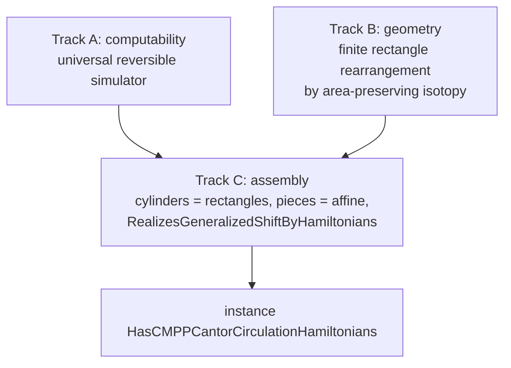

# MISSION DIRECTIVE (CMPP): Discharge `HasCMPPCantorCirculationHamiltonians`

**Goal.** Remove the last external hypothesis from the Turing-complete headline theorems of `S4TuringPoisson`
by constructing an instance of `HasCMPPCantorCirculationHamiltonians`
(`S4TuringPoisson/Smoothing/DiskSmoothing.lean:1696`), i.e. formalize the smoothing step of
Cardona–Miranda–Peralta-Salas–Presas (CMPP21, §4–5, Thm 5.2) in Lean 4 (`v4.36.0`, Mathlib + TauCeti `v4.36.0`).

Prerequisite reading: `AUDIT.md`, `MISSION_DIRECTIVE.md` (§1.3 axiom standard, §2 swarm rules, §6 gates),
`.agents/rules/lean-integrity.md`. All rules there (zero `sorry`/`axiom`, junk-value vigilance, 24 GB RAM
guardrails, 5-retry escalation to Carbon, exclusive file ownership, isolated `.worktrees/<worker>`) apply unchanged.

---

## 0. What the audit established (facts, verified in the repo)

| Fact | Evidence |
|---|---|
| No instance of `HasCMPPCantorCirculationHamiltonians` or `HasTuringCompleteAreaPreservingDiskIsotopy` exists | `grep` over all of `S4TuringPoisson/` |
| The class has **two** non-trivial fields, not one: `sim : UniversalReversibleSimulator` and `generators`/`realizes_shift` | `DiskSmoothing.lean:1553,1696` |
| **No `UniversalReversibleSimulator` is constructed anywhere** | only the `structure` and consumers exist |
| `realizes_shift` demands **exact** equality `time-1 map (cantorDiskEmbed enc s) = cantorDiskEmbed enc (Φ.eval s)` for **all** `s : ℤ → A` | `RealizesGeneralizedShiftByHamiltonians` |
| TauCeti has **no** Moser trick, disc theorem, or isotopy-extension for embedded discs. It has Palais-style extension by the identity (`IsLocalDiffeomorph.exists_diffeomorph_extend`), Schoenflies, time-dependent flows, Hamiltonian vector fields, and `mpullback_timeDependentFlowOf_of_mextDeriv_interior_eq_zero` | grep of `.lake/packages/TauCeti` |
| Already available and proved | exact bumped rotation / hyperbolic stretch / rigid translations on balls (`bumpedRotationIsotopy`, `bumpedHyperbolicStretchIsotopy`, `sectorSwapIsotopy`); groupoid closure of `AreaPreservingDiskIsotopy`; `FinTM0.toGeneralizedShift`; `ReversibleTM` with `bijective_eval`; `universalHaltingTM0` + `primrec_map_universalInputList`; `IsTuringComplete.undecidable_orbit_reachability` |

So the mission splits into two independent tracks that meet in one assembly step.

---

## 1. Honest feasibility statement

This is **research-grade formalization**, likely comparable in size to M0–M5 (≈19.5k lines), and **either track can fail**.
Rough ranges (to be re-estimated at Gate G0): Track A 4–8k lines, Track B 6–12k lines, Track C 2–3k lines.
The plan therefore has: an early cheap milestone that improves honesty even if everything else stalls (Z), hard go/no-go gates,
and named fallbacks. Math sketches below are **proof sketches to be re-verified in Phase 0**, not established facts.

---

## 2. Decisions requested from the user before launch

| ID | Question | Default if unanswered |
|---|---|---|
| **D1** | Accept target = instance of `HasTuringCompleteAreaPreservingDiskIsotopy` (the class the main theorems use) when that is cheaper than the CMPP-specific class? `AreaPreservingDiskIsotopy` needs only a smooth area-preserving isotopy, **not** Hamiltonians | Yes: prove CMPP-class instance if reachable, otherwise the Interfaces-class instance |
| **D2** | `IsTuringComplete` quantifies over **all** `FinTM0 M`, forcing a *universal* reversible machine. Allow a fallback theorem "Turing complete relative to one fixed universal machine" (enough for undecidability)? This changes headline wording | **No** for the primary result; fallback allowed only as a clearly labelled weaker theorem |
| **D3** | May `cantorDiskEmbed` / the bridge `UniversalReversibleSimulator.turingCompleteWitness` be redesigned (e.g. wider digit gaps, semiconjugacy instead of exact equality)? | Prefer **no**; allowed only if Gate G2 fails |
| **D4** | Budget/time cap and whether to run Track A and Track B in parallel (2 Lean workers max under the RAM cap) | Parallel, 2 workers |

---

## 3. Math architecture

### 3.0 Notation
`B := cantorBase N` (= `2N−1`), `K := range (cantorDiskEmbed enc)`, `ω := planeAreaForm`, `Φ` a bijective generalized shift on
`shiftDom3 = {-1,0,1}` with local data `(F, G)`.

### 3.1 Track C first-principles facts (Phase 0 must confirm each against the real definitions)
- **C1 (prefix windows).** For `F ∈ {-1,0,1}` the window `D+F` contains `0`. Hence every cylinder on `D+F` is exactly
  `K ∩ (axis-parallel closed rectangle)`: positions `≥ 0` form a prefix of the x-digits, positions `< 0` a prefix of the y-digits.
- **C2 (disjointness).** Two such rectangles are disjoint iff the corresponding cylinders are disjoint (middle-Cantor gaps give positive distance).
  Since `Φ` is bijective on all of `A^ℤ`, the image cylinders `Φ(C_w)` are pairwise disjoint, so the **image rectangles `Q_w` are pairwise disjoint**, as are the domain rectangles `P_w`.
- **C3 (affine pieces).** On each domain cylinder `C_w`, `cantorDiskEmbed ∘ Φ = A_w ∘ cantorDiskEmbed` with `A_w(x,y) = (B^{F}x + a_w, B^{-F}y + b_w)`:
  diagonal, `det = 1`, orientation preserving, and `A_w(P_w) = Q_w`.

**Consequence (reduction).** `RealizesGeneralizedShiftByHamiltonians` follows from the **Finite Rectangle Extension Theorem (FRET)** below,
applied to `{(P_w, A_w)}`, because the class only needs equality *on `K`*, and `K ∩ C_w ⊆ P_w`.

### 3.2 Track B: FRET (the geometric heart)

> **FRET.** Let `P_1..P_n` be pairwise disjoint compact sets in `Metric.ball 0 r` (`r<1`) with nonempty interior,
> `Q_i = A_i(P_i)` pairwise disjoint in the ball, `A_i` affine with `det = 1`. Then there is a smooth area-preserving isotopy
> `d : ℝ × ℝ² → ℝ²` (compact support in `ball 0 r'`, `r'<1`, `d 0 = id`, joint `C^∞`, with smooth inverse family) with `d 1 = A_i` on `P_i` for all `i`.

Why not hand-routing: pieces are thin, interleaved, and the digit gap equals the piece width, so there is no clearance for rigid translation through channels.
Hence the proof sketch below uses topology (free motion of shrunken pieces) plus a **parametric Moser correction**:

1. **T1: isotopy extension in the plane.** A smooth family of globally defined invertible affine/scaling maps `e_t^i`, with images of thickened `P_i^+` pairwise disjoint for all `t`, is realized by the flow of a compactly supported time-dependent field `X_t = Σ χ_i · ė_t^i ∘ (e_t^i)^{-1}`. Uniform separation follows from compactness.
2. **T2: collision-free motion (non-area-preserving).** Shrink each `P_i^+` radially to a tiny disc; move the discs to generic "parking" points, then to the targets (two-phase parking trick: parking points distinct from all sources/targets, so each single move avoids a finite set); expand via `A_i`-conjugated scaling. Paths: polygonal with smoothstep reparametrization (C^∞, zero velocity at corners). Result: smooth isotopy `ψ0_t`, `ψ0_1 = A_i` on `P_i^+`, **not** area preserving.
3. **T3: compactly supported divergence lemma.** For `W ⊂ ℝ²` open connected and `σ ∈ C_c^∞(W)` with `∫σ = 0`, there is a compactly supported smooth field `v` in `W` with `div v = σ`, **linear in `σ` and smooth in parameters**. Sketch: 1D primitive trick on rectangles (`v₂ = ∫ (σ − θ(y)∫σ dy)`, `v₁ = θ(y)∫ s`), then a chain-of-rectangles argument to move mass between pieces of a partition of unity.
4. **T4: parametric Moser.** With `ψ0_t^*ω = ρ_t ω`, `σ_t = ρ_t − 1`, `∫σ_t = 0` (compactly supported diffeo of `ℝ²`). Blend two primitive operators (`W = ℝ²` for `t ≤ 1−η`, `W = ℝ² ∖ N(P)` for `t ≥ 1−η/2`; valid because `ψ0_t` is constant `=ψ0_1` on `[1−η,1]` with `ρ = 1` near `P`). Moser flow `φ_t` gives `d_t = ψ0_t ∘ φ_t` area preserving, `φ_1 = id` near `P`, so `d_1 = A_i` on `P_i`.
5. **T5 (optional, only for the Hamiltonian class).** A compactly supported divergence-free time-dependent field on `ℝ²` is Hamiltonian with compactly supported smooth `H_t` (primitive by integrating `ι_Xω` along a fixed ray; support inside the filled hull). Needed only for `CompactlySupportedPlanarHamiltonian`; **skipped under D1**.

### 3.3 Track A: universal reversible simulator
Required fields (see `UniversalReversibleSimulator`): a *fixed* `ReversibleTM` `R`, `initRevCfg M t` for **every** `FinTM0 M`, accepting cylinders `acceptBlocks`, orbit equivalence with `HaltsWithWindow`, non-terminal separation at `n = 0`, and primitive-recursive digit enumerators.
Plan:
- **A1 (Church–Turing, TM→Partrec).** Normalize `FinTM0` to `Fin a`/`Fin b` tables (halting equivalence under isomorphism); show the map `(M,t,k,w) ↦ code c` with `(c.eval 0).Dom ↔ HaltsWithWindow M t k w` is primitive recursive.
- **A2 (universality).** Reuse `universalHaltingTM0` (halts iff `(c.eval 0).Dom`) as the fixed irreversible universal machine.
- **A3 (Bennett).** Generic theorem: for any `FinTM0 U` there is a `ReversibleTM R` and a computable encoding with step-by-step simulation and halt detection (history track interleaved on one tape). **Biggest single risk in Track A.**
- **A4.** Package digit enumerators (`primrec_initDigits`) and `acceptBlocks` (nonempty, independent of `t`, anti-vacuity as in `Interfaces.lean`).

---

## 4. Milestones

Conventions: each worker owns the listed files only; new files under `S4TuringPoisson/Smoothing/CMPP/`. Every milestone ends with the full gate (§6).

| ID | Owner | Deliverable | DoD |
|---|---|---|---|
| **Z** (cheap, do first) | `@unbundle` | Split the assumption: `class HasReversibleUniversalSimulator` (Track A content) and `class HasFiniteRectangleRearrangement` (FRET content). Prove `HasCMPP` (or the Interfaces class) from the two. Re-export main theorems under the two smaller classes | Builds; `#print axioms` standard; no change to existing theorem statements |
| **G0** | `@explorer-math`, `@explorer-lean` (read-only) | Confirm C1–C3 against `cantorDiskEmbed`/`GeneralizedShift.toGeneralizedShift`; inventory TauCeti/Mathlib for T1–T5 (time-dep. flows, `mextDeriv`, Cartan, bump functions, path-connectedness of `ball ∖ finite`); re-estimate lines; **go/no-go report** | Board post with exact signatures and a revised plan |
| **B1** | `@geo-isotopy` | T1 + T2: `exists_smooth_isotopy_extending_affine_on_disjoint_rectangles` (non-area-preserving) | 0 `sorry`; includes parking lemma and smooth polygonal paths |
| **B2** | `@geo-moser` | T3: `exists_compactSupport_div_eq` (connected `W`, `∫σ=0`), linear/parametric | 0 `sorry`; parameter-smoothness lemma |
| **B3** | `@geo-moser` | T4: parametric Moser, `FRET` (+ T5 if Hamiltonian class kept) | `FRET` proved for `n` arbitrary |
| **C1** | `@assemble` | C1–C3 lemmas; `RealizesGeneralizedShiftByHamiltonians` (or isotopy analogue) from FRET | Works for any bijective `Φ` on `shiftDom3` |
| **A1–A4** | `@comp-universal` | Track A (above) | `UniversalReversibleSimulator` constructed |
| **F** | `@assemble` | `instance : HasCMPPCantorCirculationHamiltonians` (or Interfaces class per D1); remove the hypothesis from `Main.lean` theorems; add *unconditional* `*_turingComplete_*` versions | Root `lake build --wfail`; global `collectAxioms` audit; `AUDIT.md` updated |

**Verifiers** (`@verifier-geom`, `@verifier-comp`) keep the original gate duties. Additional required witnesses in `Checks/`:
(i) FRET applied to a concrete 2-rectangle swap and to a concrete hyperbolic piece (non-vacuity, area, support radius `<1`);
(ii) the final instance applied to `Sphere4` yields `IsTuringComplete` with **no typeclass argument**, and Gate 6 (`M_halt`/`M_loop`) holds unconditionally.

---

## 5. Decision gates and fallbacks

- **G0 (after exploration).** Stop and report if C1–C3 fail against the real definitions (then D3 applies) or if T1–T4 cannot be mapped onto TauCeti's API with a credible plan.
- **G1 (after B1).** If T2 (parking-trick isotopy) exceeds ~3k lines, escalate to Carbon-only and re-plan before B2.
- **G2 (after B2/B3).** If parametric Moser (T4) stalls: fallback **F-sem**: weaken to semiconjugacy (chart of the invariant Cantor set of a constructed horseshoe-type map) per D3, accepting redesign of the bridge.
- **GA (Track A, A3).** If Bennett's construction exceeds budget: fallback **F-fixed**: per D2, deliver "Turing complete relative to the fixed universal machine `universalHaltingTM0`" with explicit labelling; this still yields undecidability.
- **Never** introduce `axiom`/`sorry`; any residual external input stays an explicit `class` (mission rule §1.3), and `AUDIT.md` must list it.

---

## 6. Verification rubric (all must hold per milestone)

1. `LEAN_NUM_THREADS=2 lake build --wfail` on the worker branch and on merged `main` (0 errors/warnings, ≤100 columns).
2. Comment-stripped scan: no `sorry|admit|axiom|unsafe|implemented_by|native_decide|opaque|maxHeartbeats`.
3. `Lean.collectAxioms` over every new declaration: subset of `{propext, Classical.choice, Quot.sound}`.
4. Non-vacuity witnesses (concrete instances of every new structure/class/theorem hypothesis).
5. Junk-value vigilance: explicit `ContDiff`/`det = 1`/nonvanishing hypotheses; no hidden `fderiv = 0` cases.
6. Final: updated `AUDIT.md`; the two audit gaps from the previous audit are either closed or restated honestly.

---

## 7. Roster, models, resources

- Coordinator, verifiers, `@geo-moser`, `@comp-universal` (Bennett): **Gemini 4 Carbon (High)**.
- Routine algebra, bump/inequality boilerplate, polygonal-path bookkeeping: headless local `gemma4:12B` via `tools/ollama_lean4_client.py` (`num_ctx=32768`, `OLLAMA_NUM_PARALLEL=1`); escalate after **>5** failed tactic cycles.
- At most **2** concurrent Lean workers (Track A ∥ Track B); all others parked. `export LEAN_NUM_THREADS=2`.
- Isolated worktrees: `bash tools/bootstrap_worktree.sh <worker> main`; merge `--no-ff` only after both verifiers pass.
- Pause / resume: `python3 tools/workflow_control.py pause|resume|status` (extend `CONTRACT_FILES` with the new modules).

## 8. Phase 0 explorer questions (read-only)

1. Exact coordinate formulas of `cantorDiskEmbed`, `cantorCylinderRect`, `cylinderIcc`, `negHalf`/`nonnegHalf`; confirm C1–C3 including signs of `F`.
2. How `FinTM0.toGeneralizedShift` and `ReversibleTM.toGeneralizedShift` define `(F, G)`; is `F` a function of the leading digit only (simplifies `Σ'`)?
3. TauCeti inventory for T1–T5 (time-dependent flow of non-Hamiltonian fields, pullback of time-dependent forms, `ContDiffBump` of compact sets, `IsOpen.exists_smooth...`, path-connectedness of `ball ∖ finite`).
4. Is Mathlib's `Turing.TM0` ↔ `Nat.Partrec.Code` direction (TM→Partrec) available anywhere? Estimate A1.
5. Check whether `AreaPreservingDiskIsotopy` really suffices downstream (M4/M5 use only the isotopy fields, not the Hamiltonian structure) to justify D1.

## 9. References
CMPP21 (arXiv:2012.12828) §4–5 and Thm 5.2; Moore, *Unpredictability and undecidability in dynamical systems* (1990); Bennett 1973;
Moser 1965; Dacorogna–Moser 1990; Palais 1960; Guibas–Yao (translation separability, background only).
